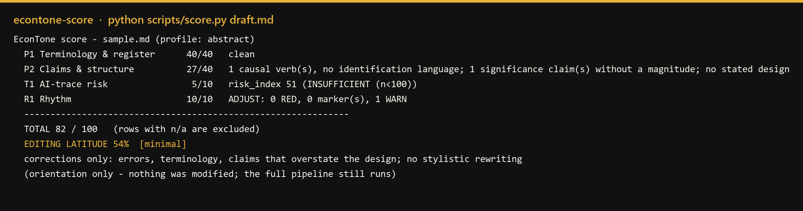
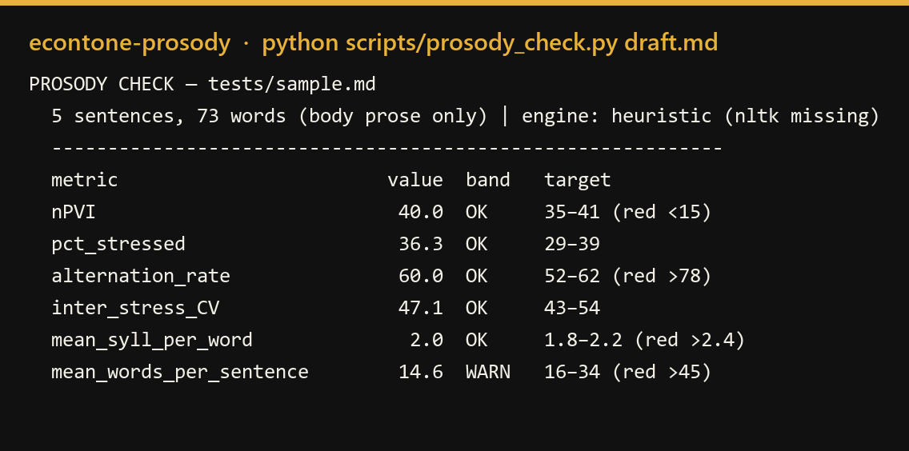

<p align="center">
  
</p>

<p align="center">
  <b>Game-theoretic optimization of economics writing.</b><br>
  Five skills play a game over your prose. Not a vote — an equilibrium.<br>
  Terminology is a hard constraint. Rhythm is an enhancement. Every refused move is recorded.
</p>

<p align="center">
  
  
  
  
</p>

---

Polishing a paragraph is not one decision. It is a conflict: the tighter sentence loses a canonical term,
the clearer claim loses its hedge, the smoother cadence loses its teeth. Most tools resolve that conflict
silently, with a fluency score.

EconTone resolves it as a **game**. Three players, disjoint moves: `econtone-polish` rewrites inside
sentences under a hard constraint, `econtone-ai-trace` cleans the voice without weakening that constraint,
and `econtone-prosody` moves sentence boundaries and **nothing else** — so it cannot damage what the other
two established. A fourth skill scores the draft before anyone touches it. A fifth computes the equilibrium.

**The equilibrium is computed by a script, not a vote.** `play.py` measures every candidate move, applies the
rules, and writes a certificate: the schedule, each accepted move, each refused move, and the number that
refused it.

```
terminology       hard constraint — never traded
claim strength    hard constraint — never traded
AI traces         second objective
rhythm            an enhancement, maximised and then abandoned
```

Ask it to polish this sentence and it hands it back with a gap:

> "Phase III significantly expanded the labor skill premium **([MAGNITUDE?])** through two channels …"

A fluent rewriter supplies a plausible coefficient. This one marks the hole and hands the decision back.
**The refusal is the product.**

> **Status: testing.** The framework, the instruments and the certificate are in place; the
> evaluation is thin — two texts, eight coalitions, no large-scale benchmark. Treat the numbers
> as measurements of the tools, not proof that the tools are right.

## Why star this

| | |
|---|---|
| **The orchestration is a game, not a vote** | A lexicographic Stackelberg equilibrium: terminology and claim validity are hard constraints, traces second, rhythm an enhancement. The follower moves sentence boundaries and cannot touch a word, so it **cannot** damage the leader's constraints — by construction, verified by a guard rather than a model. |
| **It measures before it edits** | Every draft is scored on four checks; the score sets an *editing latitude* — at 25% the editor may fix errors only, at 98% it may restructure. No other writing tool tells you how hard it is allowed to press. |
| **Its rhythm bands are calibrated, not asserted** | 10th–90th percentiles of **42 open-access papers** (2016–2021, every one CC-licensed): 42 abstracts, 42 introductions, **802 body paragraphs**. Before recalibration the old bands rejected 61–76% of published prose; they now flag 17%. |
| **It says no to itself** | The trace pass that "improves" a sentence can push burstiness into the red. The pipeline records that move as **rejected** — with the metric it would have broken. Rejected moves are the evidence, not the failure. |
| **Five skills, each complete alone** | *聚是一团火，散是满天星* — together a fire, apart a sky full of stars. Polish a paragraph, gate a rhythm, check for AI traces: each is a standalone tool. |
| **Everything is checkable** | 12/12 checks run without an agent harness; deterministic scripts; the equilibrium certificate lists the admissible schedule and every rejected move. |

## The pipeline

```
  draft
    │
    ├─ 1  econtone-score        four-row scorecard → editing latitude        (read-only)
    ├─ 2  econtone-polish       terminology · register · claims → Blocks A + B
    ├─ 3  econtone-ai-trace     three scanners → rewrite → re-measure
    ├─ 4  econtone-prosody      nine rhythm metrics · seven legal moves · seven red-line markers
    └─ 5  econtone-equilibrium  the optimal combination of 2–4, with a certificate
```

**Lexicographic, not weighted.** A rhythm gain never buys a canonical term; a trace fix never buys an
overclaim. The equilibrium engine runs `score → polish → ai-trace → prosody` only because the other five
orderings are inadmissible — the reason is written out in the skill, not assumed.


## The five skills

| Skill | Role | README |
|---|---|---|
| `econtone-score` | triage: scorecard + latitude | [README](skills/econtone-score/README.md) |
| `econtone-polish` | drafting: rules, patterns, terminology | [README](skills/econtone-polish/README.md) |
| `econtone-ai-trace` | gate: three scanners, delta table | [README](skills/econtone-ai-trace/README.md) |
| `econtone-prosody` | gate: metrics, guard, rhythm score | [README](skills/econtone-prosody/README.md) |
| `econtone-equilibrium` | orchestrator: game, certificate | [README](skills/econtone-equilibrium/README.md) |
## See it run





A full pass with every intermediate output committed: [`examples/`](examples/README.md) — a synthetic draft
that starts at **56/100** and ends at **97/100**, with the `[MAGNITUDE?]` gap left in on purpose.

## Evidence

| Claim | Number |
|---|---|
| Rhythm bands describe real papers | 42 papers · 22 journals · 802 paragraphs · CC BY 38 / CC BY-NC 4 |
| The gate does not reject published prose | old bands failed 61–76% of those paragraphs; now 17% flagged, 9% carry a marker |
| Thresholds cannot drift silently | 29 self-test assertions + 7 golden fixtures (4 must PASS, 3 must REVISE) |
| The writing rules come from the field | 32 rules from six graduate guides, each tagged with its source |
| The engine is honest about combination | Shapley over the eight coalitions: polish **−5.53**, trace **+9.02**, prosody **+5.82** on `rhythm − risk` — and `{trace, prosody}` (88.0) beats all three (80.6), because polish buys validity that the composite cannot price. |

## What it refuses to do

- Invent a magnitude, a coefficient, or a citation. It writes `[MAGNITUDE?]` and stops.
- Trade a canonical term for a shorter synonym.
- Let the rhythm pass rewrite words — it may move boundaries and seven licensed moves, nothing more.
- Vote. When two versions are defensible, it computes an equilibrium and records the dissent.

## Install

```bash
git clone https://github.com/pykkkkk/EconTone.git
cp -r EconTone/skills/econtone-* ~/.dsh/skills/          # macOS / Linux
```

```powershell
Copy-Item -Recurse EconTone\skills\econtone-* "$env:USERPROFILE\.dsh\skills\"   # Windows
```

Or point the DSH skills root at `EconTone/skills/` and they are discovered in place. Nothing here depends
on harness internals: the scanners are standard-library Python, the references plain Markdown.

## Repository

```
.
├─ README.md
├─ pack.json                 manifest: members, objectives, ownership, instruments
├─ skills/                   five skills, one folder each
│  ├─ econtone-score/        triage: scorecard + editing latitude
│  ├─ econtone-polish/       drafting: 32 rules, 37 patterns, 135 term pairs
│  ├─ econtone-ai-trace/     three scanners, risk_index, delta table
│  ├─ econtone-prosody/      nine metrics, five markers, segmentation guard, rhythm score
│  └─ econtone-equilibrium/  the game, the certificate, shapley / bargain / core
├─ examples/                 one run, start to finish
├─ tests/                    the 8 checks CI runs
├─ docs/                     provenance, positioning vs RCBSF, trademark, first measurements
└─ logo/brand/
```

## Design notes

- **Two players, disjoint moves.** Word edits belong to polish and ai-trace; sentence boundaries belong to
  prosody. Because a boundary move cannot change a word, the leader's constraints are invariant to the
  follower's strategy — a structural guarantee, not a supervisory one.
- **Rhythm is an enhancement.** It maximises a proximity score and stops when no legal move helps; it is
  never forced to hit a band.
- **The certificate is the deliverable.** Schedule, accepted moves, rejected moves, and the stopping
  condition are printed, so a reader can re-run the guards and reproduce where the system stopped.

Positioning against the nearest prior work (RCBSF, Findings of ACL 2026): [`docs/positioning.md`](docs/positioning.md).
First equilibrium measurements: [`docs/equilibrium-results.md`](docs/equilibrium-results.md).

## Built on DSH

EconTone was developed on **DeepSeek Harness (DSH)** and ships in DSH's skill format: every member is a
directory holding a `SKILL.md` (YAML frontmatter plus instructions), optionally with `scripts/` and
`references/`. Point DSH's skills root at `skills/` and all five are discovered — no build step, no manifest.

```powershell
Copy-Item -Recurse skills\econtone-* "$env:USERPROFILE\.dsh\skills\"
```

The dependency stops there. No script imports a DSH API, none reads a harness variable, and nothing assumes a
particular model. The scanners are standard-library Python; the instructions are Markdown. That is deliberate:
a tool that certifies *writing* should be checkable without the harness that happened to run it.

| Environment | How it runs |
|---|---|
| DSH | native — the five skills load as skills |
| any harness that reads `SKILL.md` | native — same layout |
| plain shell / CI | `python tests/run_all.py` (12 checks, no model, no network) |

## References

The full list lives in [`docs/references.md`](docs/references.md) — APA 7th edition, in five sections:
writing guidance, methodology, terminology sources, the rhythm literature, and AI-detection work. It runs to
over a hundred entries and is kept out of this page on purpose.

What the citations mean: a work appears there because something in the repository depends on it — a method
whose definition we implemented, a guide whose advice we paraphrased, a catalogue we checked. The **numbers**
in this project (bands, thresholds, marker levels, the composition of `risk_index`) are its own calibration
and appear in none of those works.

## Credits

- **DeepSeek Harness** — the environment the pack was developed in and the format it ships in.
- **`logo-design`** (MIT, [`kaankiziltug/logo-design-skill`](https://github.com/kaankiziltug/logo-design-skill)) —
  the design process and the `svg_audit.py` that scored the masters. The mark itself was drawn from scratch;
  its 1,432-logotype library was searched only to learn which shapes the category already owns, so the result
  could avoid them. Nothing from it was traced. Full account: [`docs/logo-notes.md`](docs/logo-notes.md).
- **The calibration corpus** — 42 open-access papers, cited in [`docs/references.md`](docs/references.md) and
  never redistributed. Their numbers describe published prose; they are not endorsements of this project.

## Licence

Apache-2.0 for code, CC0 1.0 for prose (no attribution required), the name and mark not licensed. Why:
[`LICENSING.md`](LICENSING.md). Third-party works are cited and never distributed:
[`docs/provenance.md`](docs/provenance.md).
